

  <h1>🤖 TP4 : Bases d'Ansible (Inventaire, Playbooks, Clés SSH, Rôles)</h1>
  
<strong>Automatisation de l'infrastructure avec Ansible</strong>

  
  
  
  
  

 

> **Objectif :** Maîtriser les bases d'Ansible en déployant une infrastructure complète (serveur web, Docker, Jenkins, Portainer) sur deux nœuds gérés, en passant d'une authentification par mot de passe à une authentification par clé SSH, et en réorganisant les playbooks en rôles réutilisables.

   
  📄 <strong><a href="./TP4.pdf">Télécharger le rapport complet du TP4 (PDF)</a></strong>
    

---

## 🚀 Partie 0 & 1 : Préparation et Configuration

Installation des outils sur le nœud de contrôle et configuration de l'inventaire pour cibler les nœuds `.22` et `.23`. Ajout des empreintes SSH pour sécuriser les connexions.

### Installation d'Ansible et sshpass
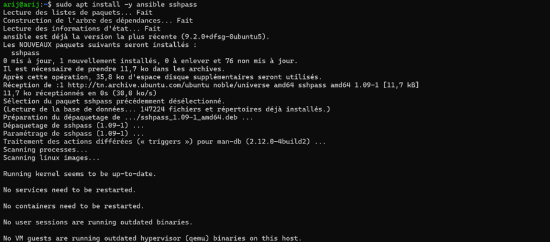
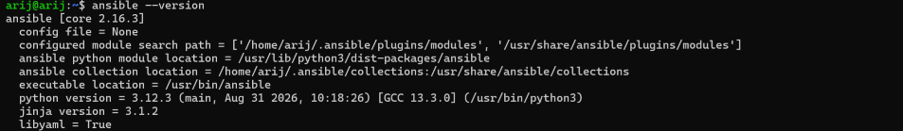

### Ajout des empreintes SSH (Known Hosts)
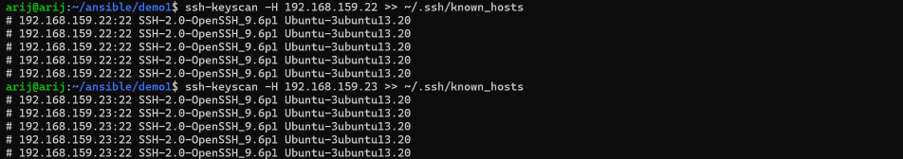

### Test de connexion avec le module Ping
Vérification de la communication avec les deux nœuds gérés.
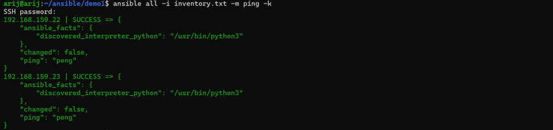

---

## 📜 Partie 2 : Premier Playbook (Installation d'Apache)

Création du playbook `webserver_install.yml` (disponible dans ce dépôt) pour installer Apache et déployer une page web statique.

### Vérification et Exécution
Test de la syntaxe, exécution en mode "Dry-run", puis exécution réelle suivie d'un test `curl`.
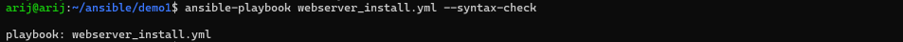
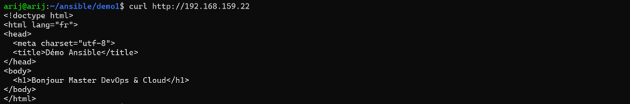

### Test de l'idempotence
Deuxième exécution du playbook montrant `changed=0`.
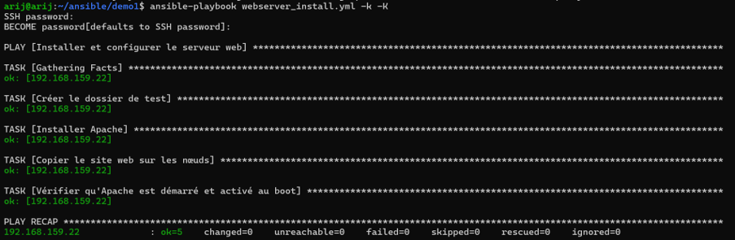

---

## 🔑 Partie 3 : Authentification par Clé SSH

Génération d'une paire de clés ED25519 et copie de la clé publique sur les nœuds gérés avec `ssh-copy-id`.

### Génération et Copie de la clé
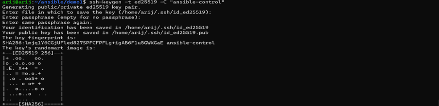
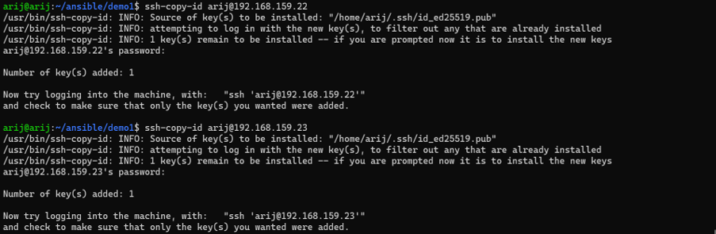

### Exécution sans `-k`
Le playbook tourne désormais sans demander le mot de passe SSH.
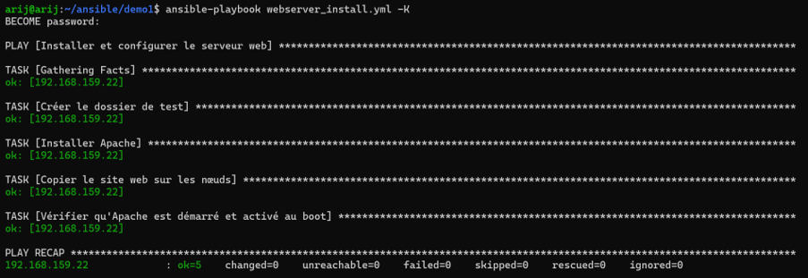

---

## 🐳 Partie 4 : Déploiement de Conteneurs

Création du `Dockerfile` et du `docker-compose.yml` pour le site web. Le playbook `docker_install.yml` (disponible dans ce dépôt) installe Docker, Portainer, Jenkins et lance le conteneur web.

### Interfaces Web
Les services sont accessibles depuis le navigateur :
*   **Portainer** (Gestion Docker) : `http://192.168.159.22:9000`
*   **Jenkins** (CI/CD) : `http://192.168.159.22:8081`

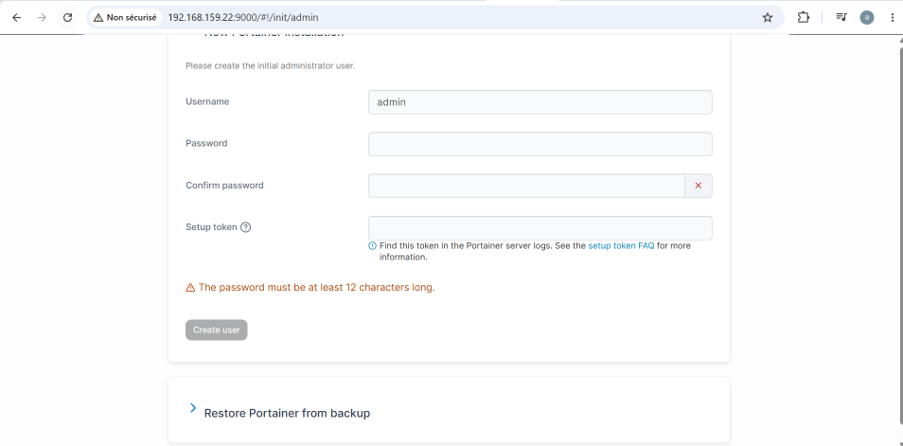
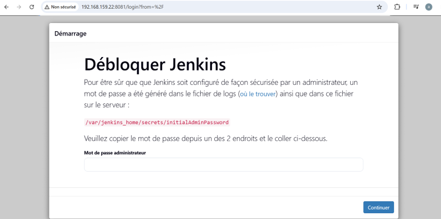

---

## 🧩 Partie 5 : Réorganisation en Rôles

Découpage du playbook monolithique en trois rôles distincts (`docker_portainer_install`, `jenkins_install`, `container_deployment`). Le code de ces rôles est disponible dans le dossier `roles/` de ce dépôt.

### Création des rôles
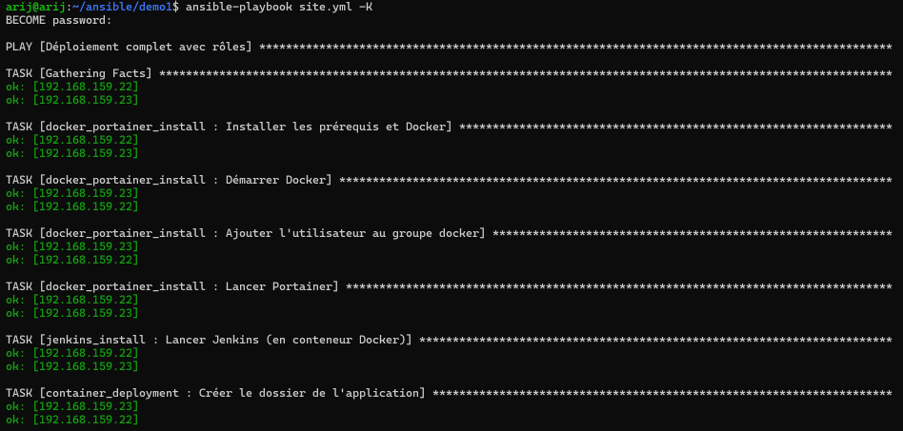

### Exécution finale et Idempotence
Exécution du playbook `site.yml` avec `changed=0` au deuxième passage, prouvant une gestion d'état parfaite.
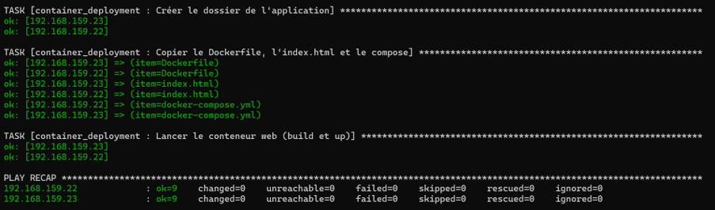

---
*Réalisé par [Arij Belaid](https://github.com/arijbelaid) dans le cadre du cours de DevOps.*
